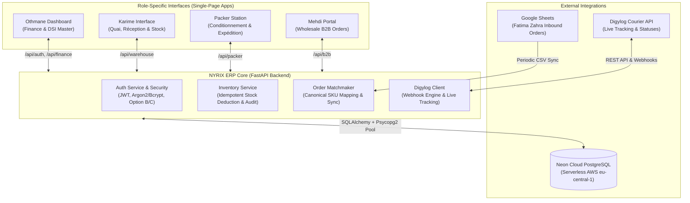

# NYRIX ERP Core System

**Enterprise Logistics, Landed Cost & Multi-Channel Distribution Platform**  
*Engineered by **AVYR Digital** (Salaheddine CHIKHI) for High-Volume E-Commerce & Wholesale Distribution in Morocco.*

---

## 📋 Executive Overview

**NYRIX ERP** is a proprietary on-premise and cloud-ready Enterprise Resource Planning system specifically architected to bridge the physical reality of a central fulfillment warehouse with financial accounting and automated courier dispatch.

Designed for rapid-turnaround cash-on-delivery (COD) e-commerce and wholesale B2B networks, the platform provides an immutable, single-source-of-truth database that unifies:
1. **Container Inbound Procurement & Landed Cost Computation** (Purchase price + freight + customs + transit).
2. **Loading Dock Reception & Discrepancy Reconciliation** (Physical container counting vs. supplier packing lists).
3. **Picking & Packaging Station Synchronization** (Internal dock-to-packer transfers with dual-signature handshake).
4. **Automated Order Matchmaking** (Live ingestion from Google Sheets and live reconciliation with Moroccan couriers).
5. **Real-Time Carrier Integration & Webhooks** (Digylog API parcel tracking, dispatch scanning, and COD cash accounting).
6. **Strict Role-Based Financial Masking** (Warehouse leads and packers see physical units; margins and landed costs remain restricted to Financial Administration).

---

## 🏗️ System Architecture & Technology Stack



### Backend Engine
* **Runtime:** Python 3.10+ / 3.11
* **Framework:** **FastAPI** (Asynchronous, high-throughput REST API with automatic OpenAPI validation)
* **ORM:** **SQLAlchemy 2.0** with connection pooling (`pool_pre_ping=True`, `pool_recycle=300`)
* **Database Driver:** `psycopg2-binary`
* **Authentication:** Python-Jose (JWT Tokens, HS256), Passlib (Bcrypt password hashing)
* **HTTP Client:** `httpx` (Asynchronous HTTP for external API handshakes)
* **Environment Configuration:** `python-dotenv`

### Primary Database
* **Database Engine:** **PostgreSQL 16 (Neon Serverless)**
* **High-Availability:** Cloud-native architecture with pooled connection endpoints (`-pooler`)
* **Monetary Precision:** Strict `NUMERIC(12, 2)` types across all financial ledgers, invoice totals, and prices.

### Frontend Architecture
* **Technology:** Modern HTML5, JavaScript (ES6+ Modules), Vanilla CSS3 / Tailwind Utility Classes
* **Icons:** Google Material Symbols Outlined
* **Design System:** Zero-framework overhead for maximum tablet and barcode scanner responsiveness.
* **Serving:** Built-in FastAPI static mount (`app.mount("/", StaticFiles(directory="frontend", html=True))`) ensuring single-origin deployment without cross-origin friction.

---

## 👥 The 4 Operational Roles & Workflows

The system strictly partitions duties according to physical station and company clearance:

| User | System Role | Primary Interface | Scope of Responsibility |
| :--- | :--- | :--- | :--- |
| **`othmane`** | `ADMIN` | [`othmane_dashboard.html`](file:///c:/Users/chikh/Downloads/NYRIX_ERP_Project/frontend/othmane_dashboard.html) | Direction DSI, supplier invoice imports, landed cost calculation, COD cash book, staff user management. |
| **`karime`** | `WAREHOUSE` | [`karime_warehouse.html`](file:///c:/Users/chikh/Downloads/NYRIX_ERP_Project/frontend/karime_warehouse.html) | Loading dock reception, physical count validation, container discrepancy logging, quai-to-picking stock transfers, joint cancellation approvals. |
| **`packer`** | `PACKER` | [`packer_tablet.html`](file:///c:/Users/chikh/Downloads/NYRIX_ERP_Project/frontend/packer_tablet.html) | Tablet workstation, barcode verification, order picking & packing, stock transfer acceptance. |
| **`mehdi`** | `B2B` | [`mehdi_b2b.html`](file:///c:/Users/chikh/Downloads/NYRIX_ERP_Project/frontend/mehdi_b2b.html) | Commercial wholesale order generation, volume tier selection, client delivery tracking (margins masked). |

---

## 🔐 Security & Access Control Model

### 1. The Delegated User Password Policy
To prevent operational staff on shared warehouse tablets from accidentally or maliciously locking accounts:
* **Self-Service Reset Blocked:** The online forgot-password modal explicitly blocks self-service resets for non-admin accounts (`karime`, `packer`, `mehdi`).
* **DSI Internal Management:** Only Othmane can reset staff passwords via the dedicated **"Accès Collaborateurs"** modal inside his dashboard (`POST /api/auth/admin/reset-user-password`).

### 2. The Admin Master Recovery Protocol
Othmane’s administrative account cannot be locked out and is protected by dual-key out-of-band authentication:
1. **Out-of-Band 6-Digit OTP:** Generated cryptographically (`secrets.randbelow`) and sent to the authorized corporate email (`ADMIN_RECOVERY_EMAIL`).
2. **Emergency Master Override Key:** In situations where internet or email access is disrupted, entering the pre-configured `DSI_RECOVERY_KEY` immediately authorizes the admin password reset.
3. **Brute-Force Lockout:** Any IP or username exceeding 5 consecutive failed reset attempts is automatically locked out for 15 minutes.

### 3. Role-Based Financial Masking
To protect company margins and supplier agreements:
* Endpoints serving the warehouse (`/api/warehouse/*`, `/api/packer/*`) completely strip `landed_cost`, purchase price, supplier identifiers, and total valuation from API responses.
* Karime and Packer see only physical unit quantities (`global_stock`, `packer_stock`).
* Mehdi's B2B portal calculates totals based exclusively on wholesale price tiers and recommended retail prices (RRP).

---

## 📦 Core Business Logic & Guardrails

### 1. Inbound Reception & Landed Cost Engine
When a container arrives at the port:
1. Othmane creates an inbound invoice (`InboundShipment`) with total item purchase costs, customs fees, transit charges, and freight.
2. The system computes the true **Landed Cost Per Unit** using weighted allocation:
   $$\text{Landed Cost} = \frac{\text{Item Purchase Price} + \text{Pro-Rated Freight/Customs}}{\text{Units Received}}$$
3. Karime receives the shipment in `PENDING` status. He inspects the physical cartons at the dock and marks the shipment `RECEPTIONNE`.
4. The units are added to `global_stock` and an immutable record is posted to `StockLedger`.

### 2. The Joint Inbound Cancellation Guardrail
* **The Problem:** If Finance deletes an invoice after the warehouse has already received the container, the physical stock on the shelves becomes desynchronized from the digital accounting ledger.
* **The Solution:**
  * Once a shipment is `RECEPTIONNE`, Othmane's direct deletion is permanently blocked (`HTTP 400`).
  * Othmane must submit a formal **Joint Cancellation Request** (`POST /api/finance/inbound-shipments/{id}/request-cancellation`).
  * Karime receives a pending cancellation badge on his loading dock view. He physically verifies the cartons are still present on the quai and either approves or rejects the reversal.
  * If approved, physical stock is deducted and a `CANCELLATION_APPROVED` audit is written. If rejected, stock remains unchanged and an audit record (`CANCELLATION_REJECTED`) is written.

### 3. Picking Transfer Handshake (Quai $\rightarrow$ Emballage)
* Karime initiates a stock transfer (`Transfer`) moving units from `global_stock` to `packer_stock`.
* The transfer enters status `IN_TRANSIT`.
* The Packer receives a notification on his tablet and clicks **"Accepter le Transfert"**.
* Units are atomically credited to `packer_stock`, preventing duplicate counts.

### 4. Idempotent Order Stock Deduction
* Order preparation triggers `deduct_order_stock_if_needed(db, order, user_id)`.
* Uses a database flag `order.stock_deducted = True`.
* Prioritizes deducting from `packer_stock`; if insufficient, it deducts from `global_stock`.
* Repeated webhooks or sync requests cannot cause duplicate stock deductions.

---

## 🔄 Data Integrations

### 1. Fatima Zahra Google Sheets Sync (Matchmaker)
* Inbound B2C customer orders are captured via Google Sheets (`GOOGLE_SHEET_ID`).
* On application startup (and on demand via Othmane's **"🔄 Sync"** button), `matchmaker.py` streams the published CSV feed.
* **Canonical SKU Matcher:** Normalizes disparate naming conventions into canonical warehouse codes:
  * `"Air-Wallet-Mag/Marron"` $\rightarrow$ `AW-MAG-BRN`
  * `"Air Wallet 299"` $\rightarrow$ `AW-01`
  * `"Portefeuille Slim Cuir"` $\rightarrow$ `WL-CUIR-001`
* Preserves existing customer statuses, payment flags, and tracking numbers.

### 2. Digylog Courier Platform
* **Real-Time Webhook (`/api/digylog/webhook`):** Receives delivery updates directly from dispatch drivers:
  * Status `'Livrée'` $\rightarrow$ Order marked `DELIVERED`, Payment marked `PAID`.
  * Status `'Retournée'` $\rightarrow$ Order marked `RETURNED`, Return ticket created.
* **Live Parcel Tracking Modal (`/api/digylog/track/{tracking_number}`):** Queries Digylog's REST API and returns a visual, chronological timeline of driver scans directly inside Karime's and Othmane's interfaces.

---

## 🛠️ Challenges Faced & Engineering Solutions

| # | Challenge | Root Cause | Engineering Solution |
| :--- | :--- | :--- | :--- |
| **1** | **Currency Rounding Errors** | Using standard IEEE-754 `FLOAT` types resulted in fractional cent discrepancies (e.g. `129.9999994 MAD`). | Migrated all financial columns and SQLAlchemy definitions to `NUMERIC(12, 2)`. |
| **2** | **Concurrent Stock Deduction Collisions** | Simultaneous order dispatches caused race conditions on inventory balances. | Implemented pessimistic row-level locking (`.with_for_update()`) on `Product` rows inside transactions. |
| **3** | **Neon Pooler Connection Resets** | Cloud serverless compute scale-to-zero dropped idle TCP connections with `SSL closed unexpectedly`. | Configured engine with `pool_pre_ping=True`, `pool_recycle=300`, and stripped driver-incompatible query strings. |
| **4** | **Unsupervised Password Resets** | Non-admin staff attempting online password resets risked credential desynchronization across stations. | Architected Option B (internal DSI credential administration) and Option C (Admin OTP + Emergency Master key). |
| **5** | **Physical Dock vs. Finance Invoice Divergence** | Direct invoice deletion after physical intake corrupted stock counts. | Implemented the two-man rule: Joint Inbound Cancellation workflow requiring warehouse physical sign-off. |
| **6** | **Global 403 Alert Interception** | Frontend `apiCall()` intercepted all 403 responses and displayed a generic alert before the modal could render the specific error. | Excluded `/auth/` routes from the global redirect interceptor (`!endpoint.startsWith('/auth/')`). |

---

## 📁 Repository Directory Structure

```text
NYRIX_ERP_Project/
├── backend/
│   ├── app/
│   │   ├── api/
│   │   │   ├── routes_auth.py          # Authentication, OTP recovery, and user management
│   │   │   ├── routes_finance.py       # Landed costs, invoices, and financial valuation
│   │   │   ├── routes_warehouse.py     # Loading dock, physical intake, and quai transfers
│   │   │   ├── routes_packer.py        # Packer tablet operations and barcode packing
│   │   │   ├── routes_b2b.py           # Wholesale B2B orders and pricing tiers
│   │   │   └── routes_digylog.py       # Courier webhook receiver and parcel tracking
│   │   ├── core/
│   │   │   ├── database.py             # Neon PostgreSQL engine and session factory
│   │   │   ├── dependencies.py         # Role-based access control (require_role)
│   │   │   └── security.py             # Bcrypt hashing and JWT token generator
│   │   ├── models/
│   │   │   └── models.py               # SQLAlchemy ORM database models and enums
│   │   ├── schemas/
│   │   │   └── schemas.py              # Pydantic request/response validation schemas
│   │   ├── services/
│   │   │   ├── inventory_service.py    # Idempotent stock deductions and ledger writes
│   │   │   ├── matchmaker.py           # Google Sheets order ingestion and SKU resolver
│   │   │   ├── digylog_client.py       # Digylog REST API integration
│   │   │   └── sheets_reader.py        # Google Sheets CSV exporter
│   │   └── main.py                     # FastAPI application setup and static mounting
│   ├── clean_demo_data.py              # Pre-launch database sanitization script
│   ├── seed.py                         # Seed initial products and user accounts
│   └── verify_*.py                     # Automated testing suite
├── frontend/
│   ├── css/
│   │   └── styles.css                  # Core application styling and design tokens
│   ├── js/
│   │   ├── api.js                      # Authenticated fetch wrapper (apiCall)
│   │   ├── auth.js                     # Login logic and password recovery handlers
│   │   ├── othmane.js                  # Finance dashboard and user management logic
│   │   ├── karime.js                   # Dock intake and warehouse operations logic
│   │   ├── packer.js                   # Tablet packing station logic
│   │   └── b2b.js                      # B2B order entry portal logic
│   ├── index.html                      # Unified login portal and master recovery modal
│   ├── othmane_dashboard.html          # Direction DSI and Financial interface
│   ├── karime_warehouse.html           # Warehouse Quai & Réception interface
│   ├── packer_tablet.html              # Conditionnement tablet interface
│   └── mehdi_b2b.html                  # Wholesale B2B commercial interface
├── .env.example                        # Documented environment variables template
├── LICENSE.md                          # AVYR Digital On-Premise Proprietary License
└── requirements.txt                    # Python backend dependencies
```

---

## 🧪 Verification & Automated Testing

The codebase includes targeted automated end-to-end and security test suites located in `backend/`:

* `python backend/verify_login_features.py` — Validates Option B delegated password resets and Option C DSI master overrides.
* `python backend/verify_inbound_cancellation_workflow.py` — Tests dock intake and verifies that received shipments cannot be deleted without joint approval.
* `python backend/verify_meeting_feedback.py` — Tests live order valuation, stock deductions, and audit ledger entries.
* `python backend/clean_demo_data.py` — Pre-launch database sanitization utility.

---

## ⚖️ License & Intellectual Property

**NYRIX ERP Core System** is proprietary commercial software licensed under the **On-Premise Proprietary Software License Agreement** ([LICENSE.md](file:///c:/Users/chikh/Downloads/NYRIX_ERP_Project/LICENSE.md)).

* **Copyright (c) 2026 Salaheddine CHIKHI / AVYR Digital. All Rights Reserved.**
* **Licensed strictly for on-premise execution by the designated licensee.**
* **Unauthorized copying, reverse engineering, multi-tenant cloud resale, or distribution is strictly prohibited.**
